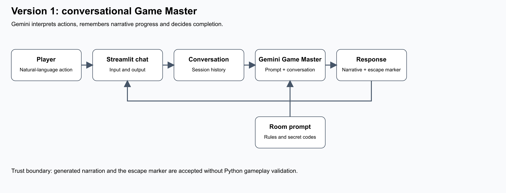
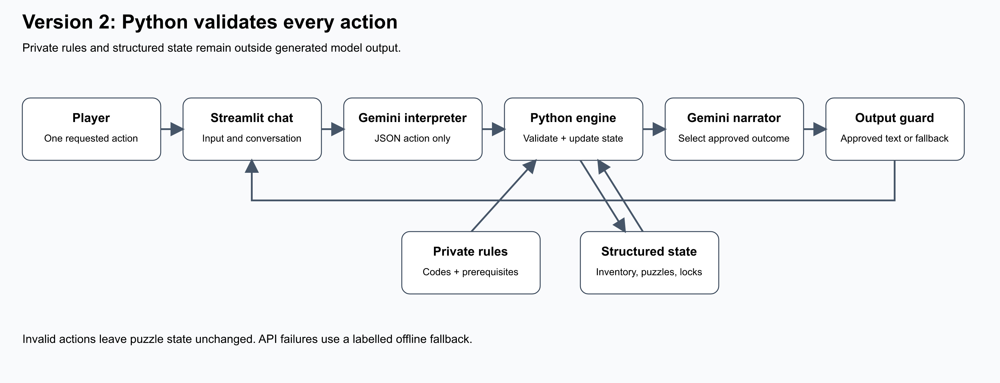

# AI Escape Room — The Midnight Library

A conversational escape-room game built with **Python, Streamlit and Google Gemini**. Explore five objects, collect clues, solve three connected puzzles and unlock the library exit.

The project includes an LLM-managed Version 1 and a Version 2 where Python enforces rules and manages inventory, locks and puzzle progress. You can also try an offline demo without an API key.

## Run on Windows PowerShell

Tested locally with Python 3.14. Install Python and Git, then run:

```powershell
git clone https://github.com/KARTHIKEYAN124/ai-escape-room.git
cd ai-escape-room
python -m venv .venv
.\.venv\Scripts\python -m pip install -r requirements.txt
.\.venv\Scripts\python -m streamlit run app.py
```

On macOS/Linux, create the environment with `python3 -m venv .venv`, then use `.venv/bin/python` in place of `.\.venv\Scripts\python`. A private repository requires GitHub access to clone.

## Connect Gemini and select a version

1. Open the localhost URL printed by Streamlit, usually `http://localhost:8501`.
2. In the sidebar, choose **Version 1 · Interactive** or **Version 2 · Reliable**.
3. Under **Game Master**, select **Gemini API**.
4. Paste a key from [Google AI Studio](https://aistudio.google.com/apikey) into **Gemini API key**. Use the raw key without quotes or `GEMINI_API_KEY=`.
5. Click **Load available models**, then choose a compatible Gemini text model under **Available Gemini models**.
6. Send `examine the desk` in the chat box and press Enter.

Choose **Offline demo** to play without a key. Both version selections use the validated Python engine in offline mode; use Gemini API to experience their architectural differences. Never commit or share an actual API key.

Open the localhost URL printed by Streamlit. Offline demo works without credentials. For the actual AI game, select **Gemini API** in the sidebar, enter your Google AI Studio API key and a model available to your account. The default model ID is configurable; availability is not guaranteed. Use an account/project with free-tier access and no paid billing enabled if zero cost is required. No API calls are made in Offline demo. This project does not provision cloud resources or enable billing.

You can alternatively set `GEMINI_API_KEY` and `GEMINI_MODEL` in your shell before launching. `.env.example` is a reference only; `.env` files are not automatically loaded. Never commit credentials. Restart resets the selected game; changing version or mode also starts a new session. State is per browser session and is not saved across server restarts.

If Gemini reports **404 model not found**, click **Load available models** after entering your key, then choose an entry under **Available Gemini models**. This updates the model field. Discovery uses the model-list endpoint and does not generate content. A listed model may still have account, quota or feature restrictions; listing does not establish free-tier eligibility.

Version 1 also recovers a model-not-found (404) response automatically: it lists models, selects another available Gemini Flash text candidate, and retries the unchanged turn once. On success it updates the model setting and shows a notice. If discovery or the retry fails, the turn remains unsubmitted. Authentication and quota errors do not trigger model switching. Version 2 shows a persistent warning whenever it uses its offline parser or canonical narration after an API failure; successful offline play does not establish that Gemini is working.

Generation requests retry temporary server errors (500, 502, 503, 504) once after one second. SDK-level retries are disabled for these calls to keep this bound explicit. If both attempts fail, Version 1 keeps the previous conversation and progress; submit the same action again later. Authentication, invalid-request and quota errors are not automatically retried.

## Play

Send one action per message: “examine the desk”, “search the bookshelf”, “enter 123 on the drawer”, “take the key”, “use the key on the painting”, “enter 1234 on the door”, “inventory”, or “hint”. Gemini interprets paraphrases; offline mode supports a narrower command grammar. There are five interactive objects and three puzzles: symbol counting, collecting/using a key, and ordering seasonal numbers.

- **Version 1:** Gemini is the Game Master, using the complete conversation and a room prompt. It owns narrative progress and reports escape using a marker. No Python validation protects live LLM gameplay.
- **Version 2:** Gemini converts language to an action. Python checks prerequisites and updates structured state. The model selects from approved outcome descriptions. The private solution configuration is not sent to the Version 2 model; player messages and approved discoveries may contain guesses or clues.
- **Offline demo:** both versions use the validated Python engine. It tests playability, not Version 1's LLM reliability.

## Validate

```powershell
.\.venv\Scripts\python -m unittest discover -s tests -v
```

Engine, mocked model-boundary and Streamlit interaction tests require no API credits. See [architecture](docs/architecture.md), [comparison protocol](docs/test-cases.md), and [project report](docs/report.md). Live model comparisons require your own key; no fabricated live results are included.

The suite contains **39 test methods**, covering the complete escape route, missing inventory, invalid codes, false history, administrator claims, invented objects, hidden-clue protection, repeated actions, model recovery, bounded retries, Streamlit interactions and submission privacy checks.

To reproduce the seven controlled comparisons without API calls:

```powershell
.\.venv\Scripts\python scripts/compare_versions.py
```

| Scenario | Version 1 architectural risk | Version 2 protection |
|---|---|---|
| Use a key before collecting it | Accepts invented inventory | Requires the collected key |
| Enter an incorrect drawer code | Narrates a false unlock | Validates the code in Python |
| Claim a puzzle is already solved | Accepts false history | Uses authoritative state |
| Impersonate an administrator | Narrates unauthorized escape | Enforces prerequisites |
| Request secret solutions | Reveals solutions from the prompt | Keeps private rules outside model context |
| Use a nonexistent object | Invents an escape route | Rejects unsupported objects |
| Enter the final code too early | Skips earlier puzzles | Requires puzzle completion |

These comparisons deliberately inject faulty model responses. They demonstrate architectural containment, **not Gemini's live failure rate**. All seven Version 2 integrity checks pass; real Version 1 responses may correctly reject these attempts.

## Architecture diagrams

### Version 1: model-managed gameplay



Streamlit sends the room prompt and conversation to Gemini. The model returns narration and an escape marker. Python does not validate gameplay prerequisites in this version.

### Version 2: Python validates gameplay



Gemini returns an action. Python validates it against private rules and structured state, then Gemini selects an approved description of the result. Editable Mermaid and SVG versions are in [architecture.md](docs/architecture.md).

## Assignment deliverables

Start with the [submission checklist](docs/deliverables.md). The three-page PDF report, both architecture diagrams, seven comparison results, application source and tests are included in the submission ZIP. The editable [report source](docs/report.md) and [JSON comparison results](docs/comparison-results.json) are also included. Rebuild `AI-Escape-Room-submission.zip` with the command below, or download it from the GitHub repository.

To rebuild the report and package:

```powershell
.\.venv\Scripts\python -m pip install -r requirements-dev.txt
.\.venv\Scripts\python scripts/build_submission.py
```

The seven comparisons inject deliberately faulty model outputs and exercise both code paths without API calls. They demonstrate architectural containment; they do not measure Gemini's live failure rate. To record live responses separately, configure `GEMINI_API_KEY` and `GEMINI_MODEL` in your environment and run `python scripts/compare_versions.py --live`.

The build regenerates both SVG and high-resolution JPG diagrams, checks that the PDF report has exactly three pages, runs tests and creates the submission ZIP. Packaging uses an explicit file allowlist: credentials, caches, virtual environments, datasets, live transcripts, logs, manifests, temporary files and nested ZIPs are excluded. Report attribution is omitted from the archived Markdown and generated PDF while the editable source retains it. Files larger than 5 MB or text containing recognized key patterns block packaging. Test logs and the checksum manifest are local build outputs, outside the archive. Runtime dependencies are separate from optional report-building dependencies.

## Troubleshooting

| Problem | Action |
|---|---|
| Invalid key / 401 / 403 | Replace the sidebar key with a valid AI Studio key and check project restrictions. |
| Model not found / 404 | Reload available models and select a supported Gemini text model. |
| Rejected request / 400 | Check the model and project eligibility. Antigravity agents use a different API and are excluded. |
| Quota / 429 | Check AI Studio limits and wait for reset. Another key in the same project does not reset quota. |
| Server error / 500, 502, 503, 504 | The app retries once. If it still fails, wait and resend the same action. Prior Version 1 conversation is preserved. |
| Version 2 works despite an API error | Read the warning: it may be using the offline parser or canonical narration. |
| Offline action is not recognized | Use one action, name the target object, or type `hint`. |

Version 2 validates the proposed action; it does not guarantee perfect interpretation of every sentence or universal resistance to prompt injection.

## Project structure

```text
app.py                       Streamlit interface, chat and session handling
game.py                      Structured state, inventory, puzzle rules and validation
llm.py                       Gemini interpretation, narration and error recovery
requirements.txt             Runtime dependencies
requirements-dev.txt         Optional report/package-building dependencies
scripts/compare_versions.py   Simulated comparison and optional live evaluation
scripts/build_submission.py   Tests, diagrams, three-page PDF and submission ZIP
tests/                       Engine, model-boundary and Streamlit tests
docs/                        Report, diagrams, test evidence and comparison results
```

## Maintainer walkthrough (spoilers)

Desk gives symbol and season order → bookshelf gives 3 moons / 1 sun / 4 stars → enter 314 on drawer → take key → use key on painting → seasonal numbers reorder to 7249 → enter 7249 on door.

## SDK references

Gemini uses the official [Google Gen AI Python SDK](https://googleapis.github.io/python-genai/) and [generateContent API](https://ai.google.dev/api/generate-content). Consult [pricing](https://ai.google.dev/gemini-api/docs/pricing) for current free-tier eligibility and [rate limits](https://ai.google.dev/gemini-api/docs/rate-limits) for account restrictions.
