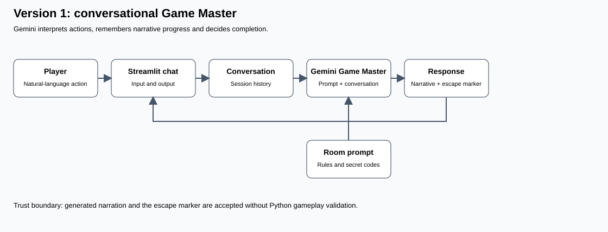
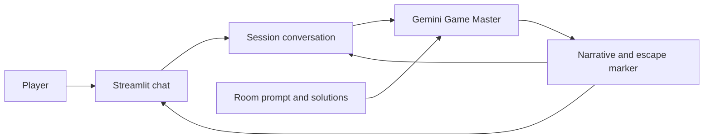
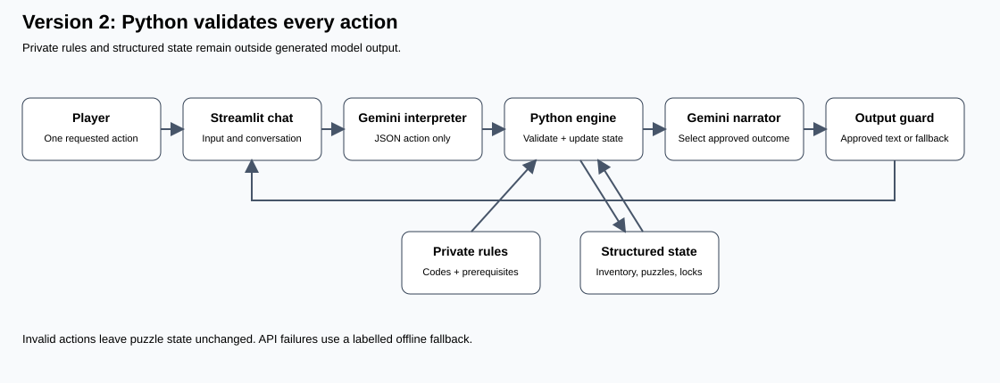
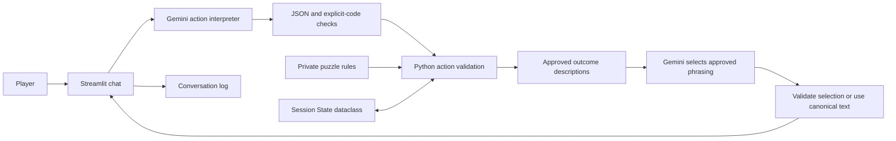

# Version 1 — model-managed game

The complete conversation is resent each turn. A model-generated escape marker controls completion. The room rules are instructions, not enforced constraints.

# Version 2 — validated game

The action interpreter receives only the current message and an action schema. It has no private room solution configuration or state, although player messages can contain guesses or discovered clues. Python ignores any unrecognized fields and does not accept state updates. Narration receives only the already-approved outcome. API/JSON failures in Version 2 fall back to the offline parser or canonical narration with a visible warning. Generation retries transient server errors once. Version 1 can discover and retry a replacement model on 404; if recovery fails, the turn remains unsubmitted.
